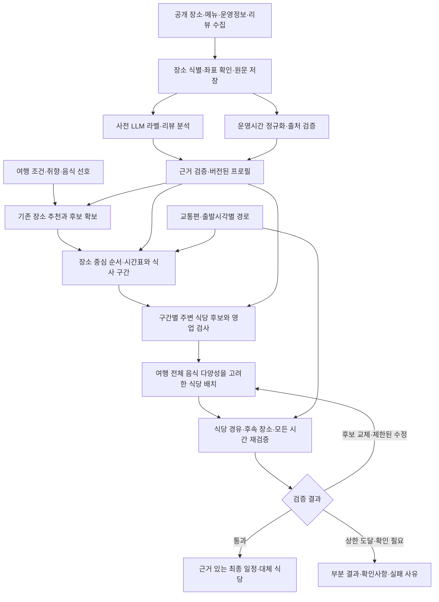

# SPEC-105: 리뷰 기반 LLM 라벨·장소 동선·여행 전체 식당 배치 설계

- 상태: Draft
- 작성일: 2026-10-06
- 최종 수정일: 2026-10-06
- 관련 이슈: 사용자 요청 — 음식점 라벨 재설계, 장소 우선 추천, 음식 다양성, 교통·영업시간 기반 동선, 리뷰 기반 방문 시간대 판단
- 관련 문서: [아키텍처](architecture.md), [데이터 계약](data_contracts.md), [추천 알고리즘](recommendation_algorithm.md), [CCU-MMR](ccu_mmr_algorithm_draft.md), [평가](evaluation.md), [안전·개인정보](safety_privacy.md)
- 관련 코드: `map-ui/ccu-mmr.js`, `map-ui/itinerary.js`, `server/travel-feedback/itinerary_service.py`, `server/travel-feedback/itinerary_validation.py`, `server/travel-feedback/llm_client.py`, `server/travel-feedback/visit_insights.py`, `server/travel-feedback/place_time_data.py`, `server/travel-feedback/route_provider.py`, `scripts/build_visit_insights.py`, `scripts/collect_place_operating_info.py`, `scripts/build_restaurant_catalog.py`, `config/restaurant_catalog.v1.sql`
- 선행 SPEC: [SPEC-009](spec_009.md), [SPEC-022](spec_022.md), [SPEC-066](spec_066.md), [SPEC-083](spec_083.md), [SPEC-085](spec_085.md), [SPEC-103](spec_103.md), [SPEC-104](spec_104.md)

> **설계 초안이며 새 기능은 미구현이다.** 이번 산출물은 현황 감사와 목표 흐름·데이터·평가 설계다. 이번 작업에서 DB 재구축, 라벨 생성, 유료 API 호출, 배포는 수행하지 않는다. SPEC-083의 현재 동작과 SPEC-104의 별도 DB 재구축을 변경하지 않는다. 사용자 요구는 승인된 방향이며 세부 분류 정의·가중치·공급자·출시 정책은 아래 제안/미결정 사항으로 구분한다.

> **1차 구현 — [SPEC-107](spec_107.md)**(2026-10-12): 이 설계의 「5. 식사 구간 주변 후보 찾기」 일부를 사전 라벨 없이 구현한다(동선 일대·영업 필터·무작위 5곳·요청 시 LLM 리뷰 판정·사람 선택). 사전 라벨링, 여행 전체 조합 최적화, 선택 후 전체 재생성은 이 문서의 장기 설계로 남는다.

## 배경 — 현재 구현 감사

2026-10-06 로컬 코드와 저장 산출물을 읽어 확인했다. 운영 서버 설정·실제 외부 API 실행 여부는 이번 감사에서 확인하지 않았다. AGENTS.md의 초기 제품 범위와 일부 과거 알고리즘 문서보다 현재 코드·최신 SPEC의 구현 범위가 넓으므로 구현 여부를 코드와 실제 데이터로 구분한다.

| 사용자 구상 | 확인된 구현/데이터 | 공백과 근거 |
|---|---|---|
| 취향에 맞는 장소부터 추천 | `ccu-mmr.js`의 `rank()`·`buildSchedule()`; 현재 버전 `ccu-mmr-v8-preference-budget`, 추천 준비 장소 1,663곳 | LLM 온라인 랭커가 아니라 기존 라벨 기반 계산이다. 일자 군집은 직선거리·하루 수용량·대표 유형 상한이며 실제 시간표와 다르다. |
| 장소 라벨에 AI 활용 | 24축/상황 라벨 산출물, SPEC-022의 신규 Kakao 2,374건 AI 초안 생성·자동 검증 기록 | 기존 24축에는 규칙 완성도 포함된다. AI 초안·자동 계약 통과가 검수 완료는 아니다. 신규 2,374건은 현행 지도 추천 번들에 미연결이다. |
| 리뷰 보고 낮/노을/밤·체류 판단 | `visit_insights.py`·`build_visit_insights.py`: 시간 문장 최소화, 근거 ID 검증, 해시 캐시·철회, LLM 연결 구현 | 실제 `visit_insights.json` 1,094곳 모두 unknown, analyzedAt 보유 0곳, 시간 근거 후보 270곳. 실제 LLM 판단 산출물은 0곳이다. 기존 리뷰는 2026-08-23 최대 5건 스냅샷이다. |
| 영업시간 별도 수집 | 음식점 수집기와 독립 카탈로그가 원문·휴무·휴게·라스트오더·출처·확인 시각 저장 | available 원문은 날짜별 영업 가능 판정이 아니다. 관광 장소용 TourAPI 소개정보 수집기·정규화기는 있지만 현재 일정 카탈로그 2,153곳 모두 operatingUnknown, operatingKnown=0이다. |
| 교통·영업시간 반영 동선 | `itinerary_service.py`: 하루 LLM 시간표 제안→실제 출발시각 경로 조회→검증→최대 1회 수정. 자동차 경로·시작/종료·필수/anchor·식사·마감 검사 코드 | SPEC-083은 In Progress, 실제 모델·경로·운영정보·프록시 품질은 미검증. `ITINERARY_ENABLED` 기본값 0이며 실제 배포 활성 여부는 미확인. 자동차만 지원하고 일자 재배정은 하지 않는다. |
| 주변 영업 중인 식당 연결 | 점심/저녁 `mealSlots`와 앞뒤 장소·우회 허용량 반환, `validate_restaurant_insertion()` 부가 검사 | `restaurantIntegrationStatus=pending`. 검색·식당 선정·영업/주문 마감 확인·실제 삽입·후속 전체 재검증은 미구현이다. |
| 로컬 맛집/알려진 식당·음식 종류 | 음식점 업종 원문 `category`와 평점·리뷰 총수·본문 저장 | 두 성격의 구조화 라벨, 메뉴/음식 분류, 여행 전체 음식 종류 관리·선정 알고리즘은 없다. 관광지의 `local_embeddedness`를 음식점 검증 라벨로 대체 사용할 수 없다. |

### 음식점 DB 감사 기준선

감사 대상으로 사용한 정본은 `data/catalogs/jeju/2026-09-21/restaurant-catalog-v1/`이다. 별도 SPEC-104는 조회 DB의 중복 JSON 제거 작업이며 새 추천 기능과 구별한다. 최종 확인 시 해당 SPEC은 Implemented이며 v2 조회 DB가 게시돼 있다. 정본·조회 값은 보존되며 이 문서의 음식/시간 라벨이 추가된 것은 아니다.

- 장소 13,561곳, 저장 리뷰 44,156건. 상세 done 13,525 / failed 36.
- 영업시간 available 10,672 / not_provided 2,777 / unrecognized 80 / uncollected 32. **미확인·미수집 112와 명시적 미등록 2,777을 따로 관리**한다.
- 실제 SQLite 읽기 전용 집계: v1/v2 모두 유효 좌표 보유 **0 / 13,561곳**. SQL은 longitude/latitude에 `CHECK(... IS NULL)`을 두므로 좌표 추가에는 새 확장 계약이 필요하다.
- `schedule_json`은 화면에서 보인 날짜/요일 원문 행이다. 반복 주간 규칙으로 확정한 데이터가 아니다.
- 음식점 카탈로그는 기존 지도·추천·공개 리뷰 API와 분리돼 있다. 리뷰 최대 5건 수집의 의견·대표성 한계와 검색 상한을 보존한다.

## 목표

1. LLM을 사전 라벨 추론·리뷰 해석·일정 제안·설명에 배치하고, 사실 확인·필수 제약·수치 최적화 책임을 명확히 한다.
2. 장소 추천→장소 중심 동선→식사 구간→주변 식당 후보→여행 전체 음식 다양성→최종 재검증 흐름을 설계한다.
3. 진행 중인 DB 재구축에서 원자료와 파생 라벨·운영 구간·경로·여행 상태를 분리할 수 있는 확장 계약을 정의한다.
4. 구현 우선순위와 실제 데이터/모델 기반 합격 기준을 남긴다.

## 비목표

- 이번 작업에서 프로그램·운영 DB·현재 추천 가중치 변경, 대량 재라벨링, 실제 LLM/경로 호출 또는 배포.
- 예약·결제, 날씨 예측, 실시간 대기열, 메뉴 재고 보장. 최신 출처가 없는 가격·휴무 등을 사실로 표현하지 않는다.
- LLM 판단을 사람 검수 완료나 일정 실행 보장으로 승격, 새로운 41축의 무조건적 전면 교체.
- 아직 정하지 않은 대중교통/도보 공급자, 모델, 로컬 맛집 정의, 비용·신선도 정책의 확정.

## 요구사항

사용자 요청에서 확인된 요구:

- `REQ-10501`: 음식점에 로컬 맛집/알려진 식당 성격과 음식 종류를 별도로 표현한다.
- `REQ-10502`: 취향에 맞는 장소를 먼저 추천하고 장소 중심 동선을 만든 뒤 주변 식당을 연결한다.
- `REQ-10503`: 식당 선정은 하루마다 독립적으로 끝내지 않고 전체 여행의 음식 종류 편중을 줄인다.
- `REQ-10504`: 실제 교통편·이동시간·영업시간·휴무·휴게·입장/주문 마감·체류·식사·시작/종료 시각을 고려한다.
- `REQ-10505`: 리뷰를 LLM API로 분석해 낮/노을/야간 방문 선호를 얻고 일정에 사용한다.

설계를 성립시키는 처리 원칙:

- `REQ-10506`: 원문 사실과 추론을 분리하고 모든 파생 주장에 출처 ID·시각·입력 해시·모델/프롬프트/스키마 버전을 연결한다. unknown·conflict를 임의 점수/정상 영업으로 바꾸지 않는다.
- `REQ-10507`: LLM 출력의 JSON 구조 검증과 실제 시간·근거·권한 검증을 각각 수행한다. 필수 제약은 다양성·인지도·취향 점수로 상쇄하지 않는다.
- `REQ-10508`: 기존 원본·정본·41축·SPEC-104 조회 DB를 보존하고 버전된 확장/sidecar를 조인한다. 관광 장소와 식당 ID를 검증 없이 합치지 않는다.
- `REQ-10509`: 후보 없음·불확실 운영정보·미지원 교통편·외부 실패·생성 실패·진짜 배정 불가능을 구분한다. 고정 장소와 날짜 조건을 조용히 변경하지 않는다.
- `REQ-10510`: 공개 장소 사전 분석을 캐시하고 사용자 요청에서 리뷰 전량 재분석을 반복하지 않는다. 후보/시간/호출/비용 상한과 오프라인 평가를 갖춘다.
- `REQ-10511`: 음식점 교체와 시간 변경 후 후속 이동·방문·식사 및 여행 전체 음식 분포를 다시 검증한다. 필수 장소·예약·사용자 확정 식사는 보존한다.
- `REQ-10512`: 사용자 일정 상태와 공개 장소 분석을 분리하고, 사용자 이름·평가 의견·정확한 위치·불필요한 민감 조건을 LLM에 전송하거나 평가 DB에 합치지 않는다.

## 입력과 출력 — 목표 계약, 미구현

### 여행 입력

- 장소 추천용: 기존 구조화된 취향·동행자·방문 의도·필수/제외 장소. 현재 점수와 선택 코스를 보존한다.
- 시간표용 필수: 실제 시작/종료일, `Asia/Seoul`, 교통편, 일자별 시작/종료 장소 ID와 시각, 필수/고정 장소, 식사 포함 방식·시간 창·길이·최대 우회.
- 음식 입력: 선호/제외 음식 종류, 명시적 반복 허용, 선택한 로컬/인지도 선호, 식당 고정 여부. 예산 등 추가 조건은 사용자가 입력하고 출처가 준비된 경우에만 적용한다.
- 날짜가 없으면 장소 탐색까지 제공하고 영업 여부·시간표는 확정하지 않는다. 비자동차는 공급자와 데이터 준비 전 미지원으로 반환한다.
- 좌표는 WGS84 `[longitude, latitude]`; 시각은 시간대 포함 ISO 8601, 계산 이동은 초, 화면은 분 올림이다.

### 공개 데이터 확장

다음은 목표 논리 테이블이다. 구체 SQL·파일 버전은 후속 구현 SPEC에서 확정한다. 복제 원문을 조회 DB에 다시 넣지 않고 정본 ID·해시로 참조한다.

| 계약 | 주요 필드/단위 | 출처와 의미 |
|---|---|---|
| `place_identity` / `provider_links` | canonical_id, provider_id, 관계 상태·방법·검수 시각 | Kakao/TourAPI 관계의 확정·애매·중복/하위시설 구별. 이름만으로 병합 금지 |
| `place_geometry` | canonical_id, longitude, latitude, source_ref, checked_at, status | 같은 공급자 ID로 받은 좌표 우선. 주소 지오코딩은 별도 추정 상태·오차를 두고 검증 |
| `restaurant_profile` | cuisine_codes[], dish_family_codes[], specialty_tags[], local_character, recognition, status | 업종/메뉴 사실과 로컬 추론·관측 기반 인지도 분리. 각 주장에 evidence_refs |
| `operating_observation` | source_id, canonical_id, source_ref, checked_at, raw_record_ref, collection_status | 정본의 운영 원문 참조. available 등 수집 상태 유지 |
| `operating_schedule` | weekly, seasonal, date_exceptions, breaks, last_admission, last_order, overnight_offset, valid_from/to, status | 실제 날짜에 방문/주문 가능한 구간. 정규화 버전·원문 연결·확정/미확인 |
| `review_claim` / `visit_profile` | period, stance, scope, dwell_range_minutes, evidence_review_ids, status, analyzed_at | 낮/노을/야간 **선호 추론**. 영업시간과 다른 계약. 근거 수·상충·대표성 표시 |
| `route_cache` | origin_id, destination_id, mode, departure_at, duration_seconds, distance_meters, queried_at, provider_version | 방향·출발시각·교통편 일치가 필요한 경로. 시각 구간 캐시는 후보 탐색용 근사임을 구별 |

모든 파생 프로필에는 `input_hash`, `model`, `prompt_version`, `taxonomy_version`, `schema_version`, `analysis_status=ai_draft|reviewed|unknown|conflict`를 적용한다. 규칙 계산이면 model=null과 rule_version을 사용한다. 모델의 자기 보고 confidence를 검증된 확률로 쓰지 않는다.

### 여행 결과와 음식 상태

- `place_recommendation`: 기존 장소 ID·원래 place_fit·근거·버전. 일정 편의 때문에 place_fit을 덮어쓰지 않는다.
- `attraction_schedule`: 날짜별 장소·도착/출발·체류·이동·식사 구간·미배정 사유·확인 필요사항.
- `meal_assignment`: 식사 구간 ID, 식당 ID, 예정 음식 그룹, 식당 도착/주문/출발, 양쪽 경로, 운영 판정·근거, 검증 상태, 대체 후보.
- `trip_food_state`: 여행 전체 예정 음식 그룹 횟수, 연속 반복, 사용 식당 ID, 고정 식사, 미분류 식사 수, 남은 구간. **실제 먹은 음식 기록이 아니라 계획 상태**다.
- `final_itinerary`: 검증된 최종 장소+식당 일정과 장소/식사/이동별 검증 상태, 데이터 확인 시각, 모든 정책/알고리즘 버전.
- 식당 DB·라벨·영업·방문 프로필·추천·교통·요청 revision이 달라지면 관련 캐시와 결과를 무효화한다. 영업 확인된 장소 일정과 식당 미선정 상태를 한 개의 성공 표시에 뭉치지 않는다.

## 설계 — 전체 목표 흐름, 미구현

### 1. 음식점 라벨 재설계

**제안:** 사용자가 말한 로컬 맛집과 알려진 식당은 독립된 두 축으로 저장한다. 유명한 로컬 식당도 있으므로 서로 배타적인 두 클래스는 근거를 잃는다.

- `local_character`: 제주 지역 음식/식재료·지역 운영 맥락·현지 단골 근거를 각각 기록한다. 지역 음식 제공과 현지인 단골 식당은 같은 뜻이 아니므로 세부 근거를 분리한다. 적은 리뷰 수를 로컬 맛집의 증거로 쓰지 않는다.
- `recognition`: 현재 관측 리뷰/블로그 총수, 확인 가능한 외부 노출 근거와 비교 모집단·기준일로 계산한 인지도. 높음/보통/unknown 등의 실제 컷은 표본 평가 전 미결정이다. 리뷰 수는 음식 맛·품질이나 로컬성의 직접 점수가 아니다.
- `cuisine_codes`: 한식/중식/일식/양식 등 큰 업종. 음식 종류 다양성을 이것만으로 판단하면 흑돼지·회·국수 모두 한식으로 뭉쳐진다.
- `dish_family_codes`: 식사의 실제 경험을 구별할 대표 메뉴군. 예: 돼지고기구이, 생선·해산물, 면류, 국물·탕류, 채식 식사 등. 실제 코드 목록과 중복 소속 규칙은 후속 표본에서 확정한다.
- `specialty_tags`: 흑돼지·갈치·고기국수 등의 메뉴/지역 특산 태그. 넓은 메뉴를 보유한 식당은 복수 값과 근거를 보존한다.
- 다양성 계산은 그 식사에 제안한 대표 음식 그룹 하나를 기준으로 한다. 복합 메뉴/미선택은 unknown으로 두고 세 가지 메뉴가 있다는 이유만으로 세 번의 다양성 보상을 주지 않는다.
- 내부 표현은 다축을 유지하되 화면에는 근거가 있는 ‘로컬’, ‘알려진’, 두 성격 동시 표시 또는 판단 보류를 제안한다. UI에서 두 버튼만 사용할지는 미결정이다.

**라벨 생성 순서:** 같은 ID의 업종·공식 메뉴 사실→규칙 매핑→LLM이 남은 의미/리뷰 근거만 판정→근거 ID·허용 코드 검증→고신뢰 극단값/상충 우선 표본 검수→ai_draft 게시. 기존 관광지 41축과 별도 확장으로 시작한다.

### 2. 리뷰로 방문 시간대·체류 판단

LLM 호출은 수집 갱신 뒤 사전 실행한다. 사용자마다 수천 리뷰를 다시 읽지 않는다.

1. 같은 장소로 검증된 리뷰에서 시간대/방문 경험 문장을 추출한다. 중복 관측·광고성·작성일 불명·소수 표본을 별도 표시하고 분석 표본 수를 보존한다.
2. LLM은 문장별 `period=daylight|sunset|night|any`, `stance=positive|negative|neutral`, `scope=place|meal|lighting|other`, 명시적 체류 범위와 근거 ID를 반환한다. ‘밤에는 별로’의 night를 야간 추천으로, ‘저녁 먹고 들름’을 야경 장점으로 바꾸지 않는다.
3. 서버가 ID·장소 연결·문장 근거·기간·분/시간 단위를 검사하고 지지/반대 주장으로 집계한다. 체류·주차·대기·운전 시간은 분리한다. 부족·상충이면 unknown/conflict다.
4. LLM/스키마/근거 검증을 통과한 선호만 `visit_profile`로 저장한다. 형식 검증이 의미 정확성을 보장하지 않으므로 독립 사람 정답과 대조한다.
5. 일몰은 여행 날짜와 좌표로 계산하고 계산 버전·추정 상태를 표시한다. ‘노을 보기 좋음’은 일몰 주변 선호를 만들며 고정 18시로 저장하지 않는다. 공식 야간 행사 시간·조명 운영은 별도 운영 출처로 확인한다.
6. 시간대 적합도는 기본적으로 소프트 선호다. 사용자가 ‘꼭 노을’로 고정하거나 공식 회차가 있을 때만 별도 필수 창을 만든다. 17시 폐장과 야경 리뷰가 충돌하면 폐장 제약을 지키고 야간 선호를 사용하지 않는다.

현재 `visit_insights.py`의 시간 단어·ID 검사만으로 지지 강도/부정/다른 대상 문장을 완전히 구별한다고 보장할 수 없다. 위 stance/scope와 평가를 보완하는 계획이며 현재 동작을 수정했다는 뜻이 아니다.

### 3. 영업시간은 별도 사실 파이프라인

- 관광 장소는 TourAPI 소개정보와 공식 장소 출처, 음식점은 기존 Kakao 운영 원문 및 확인 가능한 공식 안내를 연결한다. 새 공급자 선정은 후속 검증 사항이다.
- **원문 수집 상태→파싱 상태→해당 여행일 이용 가능 상태**를 따로 둔다. available은 ‘시간 원문 있음’이지 ‘계획한 시각 영업 중’이 아니다.
- 요일별 복수 구간, 브레이크타임, 정기휴무, 날짜 예외, 계절·휴일, 자정 넘김, 마지막 입장/주문 마감, 판매 종료 안내를 표현한다. 오늘 보이는 요일/날짜 한 줄을 매주 규칙으로 확대하지 않는다.
- 규칙 파서가 처리할 수 없는 원문은 LLM의 구조 추출 **제안**을 받을 수 있다. 모든 시각/요일에 원문 근거를 연결하고 의미·충돌 검증 전에는 known으로 승격하지 않는다. 리뷰로 현재 영업시간을 확정하지 않는다.
- 출처가 충돌하면 공식이라는 이유만으로 오래된 것을 자동 채택하지 않는다. 최신성·유효 기간·날짜 예외를 비교해 해결 근거를 남기거나 conflict로 보류한다.
- 전체 데이터는 사전 갱신하고 최종 후보만 출처 재확인 대상으로 우선한다. 신선도 한도는 출처별 설정으로 두며 SPEC-083의 개발용 30일을 운영 확정값으로 복제하지 않는다. 미래 여행일에는 예외 미확인·재확인 필요가 남을 수 있다.
- 영업 원문이 없거나 오래된 식당은 ‘해당 시간 영업 검증 완료’ 배치에서 제외하고 별도 확인 후보로 표시한다. 관광 장소도 unknown을 24시간으로 바꾸지 않으며 전체 결과는 verification_required다.

### 4. 장소 우선 추천과 동선 계산

**장소를 먼저 고른다는 뜻은 원래 추천 카드 순서를 방문 순서로 고정한다는 뜻이 아니다.** 기존 취향 랭커의 place_fit을 유지하고 동선 단계에서 순서·시간·선택 장소의 실현 가능성을 별도로 계산한다.

- 1차 구현 제안: SPEC-083의 일자 배정·필수·anchor 보존을 유지한다. 하루 최대 6곳이면 가능한 방문 순서를 제한 시간 내 탐색하고, 현재 LLM 제안을 초기 후보로 비교할 수 있다. LLM이 유일한 순서 계산기가 되지 않게 한다.
- 입력: 방향별 실제 교통시간, 체류시간, 영업 구간, 고정 방문·예약 창, 식사 포함, 출발/종료·여유시간, 날짜별 일몰 선호. 직선거리는 후보 축소용이고 도로 시간으로 대신 사용하지 않는다.
- 시작 시점 이동표는 탐색 참고값이다. 선택한 순서의 각 구간은 실제 출발시각으로 다시 조회하고 변경된 뒤쪽 구간도 재검증한다. 고정 이동표의 통과가 시간 의존 교통에서 통과를 뜻하지 않는다.
- 빠른 마감 장소는 `마감 - 체류 - 다음 조건까지 필요한 여유`가 작은 구간부터 고려한다. ‘항상 첫 방문’ 규칙보다 실제 가능한 창을 검사한다. 낮 선호는 낮, 노을은 날짜별 일몰 주변, 야경은 운영 가능한 밤으로 배치하되 필수 제약 우선이다.
- 알려진 제약을 만족한 후보 중 원래 장소 효용 보존→시간대 선호·식사 충족→도로 이동/과도한 대기 감소를 정책으로 비교한다. 선택 장소를 줄여 이동시간만 좋아 보이게 만들지 않는다.
- 관광 장소의 하루 대표 유형당 1곳 상한은 식당/식사에 적용하지 않는다. 필수·anchor는 자동 삭제하지 않고 충돌이면 조건 확인 또는 실패로 남긴다.
- 후속 확장 제안: 선택 장소의 날짜 재배정·교체는 외부 계획기로 분리하고 사용자 고정 날짜/예약/식사를 잠근다. 기존 SPEC-083의 ‘일자 불변’과 충돌하므로 후속 구현 SPEC에서 명시적으로 범위를 변경한다. 이번 설계만으로 현재 코드를 변경하지 않는다.

수식의 핵심은 시간 창이 있는 방문 순서 문제다. Google의 [OR-Tools time windows 공식 예제](https://developers.google.com/optimization/routing/vrptw)는 이동시간 행렬과 방문 허용시간을 함께 쓰는 참고다. 우리 문제에는 선택 관광지·체류·선호 시간대·식당 후보·시간 의존 경로가 더 있으므로 그 예제를 그대로 전역 최적해라고 부르지 않는다. 초기 소규모는 제한된 순서 탐색, 규모가 커지면 OR-Tools 등 최적화기 채택을 실제 비교한다.

기본 제약은 `다음 도착 ≥ 현재 출발 + 해당 출발시각의 이동시간`, `현재 출발 ≥ 현재 도착 + 체류시간`, `방문 구간 ⊆ 실제 날짜의 영업 구간`이다. 식당은 도착 뒤 대기/주문 준비를 반영한 주문시각이 라스트오더 이하여야 하고 식사 종료가 영업 종료 이하여야 한다. 휴게 구간을 가로지르거나 식사 종료만으로 주문 마감을 검사하지 않는다. 해당 필드의 unknown과 명시적 not_applicable을 구별한다.

### 5. 식사 구간 주변 후보 찾기

동선은 `A→식사→B` 또는 출발지/종료지와 연결된 식사 구간을 만든다. 고정 점심/저녁 시각을 전부 강제하지 않고 SPEC-083의 부분 일자 auto|required|excluded를 이어받는다.

1. 검증된 좌표로 식사 전후 구간 인근을 공간 검색한다. midpoint만 보지 않고 경로 주변과 앞뒤 장소 주변을 포함한다. 도서·페리 등 연결이 다른 후보는 실제 경로 확인이 필요하다.
2. 여행일·도착/주문/식사 종료의 영업 구간, 휴게·마감, 명시적 음식 제외 조건을 필터한다. 식당 존재/영업 확인과 메뉴·품질 추론의 상태를 분리한다.
3. 소수 후보만 양쪽 교통시간을 조회해 실현 가능 후보를 만든다. 새 식당 13,561곳의 모든 쌍 경로를 만들지 않는다.
4. `A→식당`, 식사, `식당→B`를 시각대로 계산한다. 단순 추가 이동 참고값은 `T(A,식당)+T(식당,B)-T(A,B)`이며 출발시각 차이가 있는 최종 판정은 실제 시간 재생성으로 한다.
5. 우회 허용량, 식사 시간, 다음 방문, 하루 종료·항공편 등 고정 마감이 모두 맞아야 후보다. 주차/도보/대기는 확인된 값 또는 명시적인 보수 가정으로 따로 반영하고 두 번 더하지 않는다.
6. 1차 일정의 우회 예약분은 실제 경유 시간으로 치환한다. 예약 20분에 실제 우회 15분을 또 더하는 방식은 금지한다. 현재 20분은 개발 기본값이며 사용자 수정/검증 정책을 보존한다.

### 6. 여행 전체 음식 다양성으로 식당 배치

**제안:** 음식 종류를 똑같은 횟수로 강제하기보다, 사용자 선호·해당 지역의 가능 후보 안에서 편중을 줄인다. ‘흑돼지를 두 번 먹고 싶다’는 명시적 선택을 균등 분포로 지우지 않는다.

- 먼저 모든 식사 구간의 실현 가능 후보 집합을 확보한다. 후보가 한 종류뿐인 구간과 선택 폭이 넓은 구간을 함께 보고, 제한된 구간에서 필요한 선택을 초반 탐욕 선택이 소진하지 않게 한다.
- 음식 효용은 음식/성격 선호·근거 있는 품질 신호·우회 부담으로 계산하고, `trip_food_state`의 같은 대표 메뉴군 누적·연속 반복·같은 식당 재방문에 소프트 페널티를 준다. 평점 원시값만으로 품질 순위를 확정하지 않는다.
- 목표식 제안: `전체 후보 효용 - 추가 이동 비용 - 같은 음식 누적 반복 - 연속 반복 - 같은 식당 반복`. 모든 항목의 스케일·가중치·반복 비용은 버전 설정과 오프라인 평가로 결정한다. 검증된 필수 제약은 목표식 앞에서 통과해야 한다.
- 소규모 여행은 식사 구간별 상위 후보의 조합을 bounded beam search 등으로 비교한다. 이후 구간의 음식 후보 유무를 포함하고, 선택 식당의 시각 변화가 후보 자격을 바꾸면 재조회·검증한다.
- 기존 하루 순차 API만으로는 다음 날짜의 후보를 볼 수 없다. 목표 구조는 공개 후보/식사 구간을 여행 전체에서 조정하는 단계와 하루 검증 단계를 분리한다. 전역 조정은 현재 탭/요청 범위 상태로 시작하고 이름/평가 DB에는 저장하지 않는다. 새 여행 계약은 후속 구현 SPEC에서 정의한다.
- 후보 없음은 추천 가능한 음식 목표 자체를 완화하거나 확인 필요 후보를 별도 표시한다. 휴무·알레르기 등 사용자가 명시한 필수 제외·고정 장소는 자동 완화하지 않는다. 메뉴 성분이 unknown이면 필수 음식 조건을 만족한다고 단정하지 않는다.
- 예시(가상): 4회 식사의 가능 후보가 첫 구간 돼지고기/면, 둘째 해산물만, 셋째 돼지고기/국물, 넷째 면이면 면을 첫·넷째에 연달아 배정하는 안보다 돼지고기→해산물→국물→면을 비교한다. 실제 제약과 선호가 맞을 때만 선택하며 4종 강제 규칙은 아니다.

### 7. 최종 검증과 LLM 책임

| 처리 | LLM 역할 | 서버/알고리즘 책임 |
|---|---|---|
| 음식 라벨 | 메뉴군·로컬 맥락의 근거 있는 분류 초안 | 메뉴 사실·출처 확인, 인지도 관측 계산, 허용 코드·근거 검사 |
| 리뷰 시간대 | 지지/반대·대상·명시적 체류 추출 | 근거 연결·상충 처리, 날짜별 일몰 계산, 공식 운영정보와 분리 |
| 사용자 조건 | 자연어 사용 시 구조화된 조건 매핑 제안 | 실제 입력 확인·필수/선호 분리. 기존 구조화 입력은 불필요한 LLM 호출 없음 |
| 방문 순서 | 제약 안의 초기 순서 후보·제한된 수정 제안 | 시간 창 탐색, 경로 조회, 필수/종료/식사·운영 검증 |
| 음식 다양성 | 필요할 때 제한된 후보 비교 설명 | 전체 여행 후보 조합·음식 횟수·반복·우회 계산과 선택 |
| 사용자 설명 | 검증된 trace·근거 ID만 자연어로 정리 | 근거 없는 주장 차단, unknown 표시. 실패 시 템플릿 설명 |

최종 검증은 식당 경유를 포함한 **모든 장소·식당·후속 구간**을 계산한다. known 위반이 남는 제안은 표시하지 않는다. 식당 선택 실패 시 검증된 관광 동선과 식사 빈 구간을 보존하고 식당이 정해졌다고 표시하지 않는다.

Structured Outputs를 쓰더라도 값의 사실성·시간 성립·근거의 의미는 별도 검사한다. 공식 [OpenAI Structured Outputs 문서](https://developers.openai.com/api/docs/guides/structured-outputs?api-mode=responses)도 구조화 결과의 내용 오류 가능성과 거절 처리를 설명한다. 모델은 사전 라벨용과 온라인 일정용을 별도 설정할 수 있게 하되 이번 문서에서 모델 접근·가격·성능을 확정하지 않는다.

## 예외와 폴백

| 상황 | 목표 처리 |
|---|---|
| 식당 좌표 미확인 | 공간 후보에서 제외·보완 큐로 전송. 주소만 보고 동선에 삽입 금지 |
| 식당 영업/휴무/라스트오더 미확인·오래됨 | 확인 후보와 미확인 필드를 표시. 영업 검증 완료 배치에 포함하지 않음 |
| 리뷰 부족/상충·의미 검증 실패 | 시간대/로컬 라벨 unknown 또는 conflict. 공식 사실과 기존 추천은 보존 |
| 원하는 음식 후보 없음 | 가능한 대체 음식/시간/우회 조건을 제안하고 필수 조건은 유지 |
| 특정 식당으로 다음 방문 마감 위반 | 다른 식당→식사 구간 내 시각 변경→잠기지 않은 동선 제한 수정 순으로 재탐색. 실패하면 식사 미배정 |
| 형식·근거·시간표 오류 | 제한된 수정 후 generation_failed. 검색 상한 도달을 전체 여행 infeasible로 부르지 않음 |
| 경로/모델 장애·상한·시간 초과 | unavailable 또는 부분 결과. 기존 추천·완료 일차 유지, 호출 예산 초과 재시도 금지 |
| 미지원 교통편·페리/회차 데이터 필요 | 미지원/확인 필요 명시. 자동차나 직선거리 시간으로 대체 금지 |
| 고정 식당·노을·마감 충돌 | 충돌 근거와 필요한 변경을 반환. 사용자 확정 조건 자동 삭제 금지 |
| 날짜/장소/식당 선택 변경·늦은 응답 | revision 검사, 관련 음식 상태·후속 일정 무효화, 최신 요청만 적용 |

사용자에게 ‘영업 중’ 대신 해당 출처·확인 시각 기준의 예정 방문 가능 여부를 표시한다. 입장/주문 가능 판정은 예약 가능·자리 확보·판매 재고 보장이 아니다.

## 영향 범위와 이행 순서 — 계획, 미구현

1. **데이터 준비:** SPEC-104 조회 DB/정본 보존 경계 위에서 이 설계 때문에 해당 스키마에 라벨을 섞지 않는다. 검증된 canonical ID를 유지하고 좌표/출처·해시 참조가 가능한 버전 확장을 먼저 만든다.
2. **최소 추천 데이터:** 식당 좌표, 대표 메뉴군, 관광 장소와 식당의 정규화 운영정보를 확보한다. 소수 장소·지역 표본으로 시간 창을 검증한 뒤 확장한다.
3. **리뷰/라벨 사전 분석:** 시간대·체류/로컬·음식 종류를 task별 schema와 캐시로 생성·검수한다. 원본 관측에서 AI 초안까지 재생성이 가능해야 한다.
4. **장소 동선:** SPEC-083 실제 외부 품질 gate를 통과시키고 제한된 순서 탐색을 LLM 제안과 비교한다. 필수·anchor·평가 UI 회귀를 유지한다.
5. **식당 연결:** mealSlots 공간 후보·영업 필터·경유·후속 검증을 붙인다. 이 단계까지는 아직 여행 전체 다양성이 완성됐다고 보고하지 않는다.
6. **전체 여행 조정:** 음식 상태·후속 후보를 함께 쓰는 조정 단계와 식당 변경·재검증을 도입한다. 새 계약·정책 버전을 분리하고 실제 품질 평가 후 운영 적용한다.

변경 후보: 위 관련 서버·UI 파일, 새 공개 확장 생성/검증 도구와 계약, 데이터 manifest, 오프라인 평가 fixture. 구체 경로·명령은 해당 구현 SPEC에서 등록한다. 구현 전 현재 정본·조회 DB·추천 결과를 보존한 검증 스냅샷을 만든다.

데이터 마이그레이션: 기존 카탈로그 v1/v2 정본 참조→검증된 좌표·식당 프로필·영업 구간 확장 조인→새 서버 카탈로그 게시→feature flag에서 점진 적용. 기존 `raw_json/source_json` 복제를 재도입하지 않는다. 읽기 전용 입력·건수/FK·해시·재구축·이전 버전 복구 경계를 유지한다.

개인정보/외부 전송: 공개 리뷰에서 작성자·연락처·불필요 문장을 최소화한다. 음식 제외 등 민감 조건은 서버 필터로 적용하고 LLM에는 필요한 후보와 제약만 보낸다. 사용자 일정·식사 상태는 현재 탭/요청에서 시작하며 장기 저장은 별도 요구사항과 고지가 필요하다. 공개 장소 프로필 캐시와 사용자 세션의 수명은 분리한다. 키와 원문 프롬프트·개인 일정은 로그에 남기지 않는다.

## 승인 기준

설계 산출물의 기준:

- `AC-10501` (`REQ-10501~05`): 사용자 요구와 현재 구현/미구현을 코드·실제 산출물로 대응하고 LLM의 온라인/사전 실행 경계를 설명한다.
- `AC-10502` (`REQ-10501~12`): 데이터·LLM·추천·동선·식당·전체 여행 상태·실패 흐름 및 단계별 이행을 정의하고 제안/미결정을 구분한다.
- `AC-10503` (`REQ-10508`): 색인·기준 문서가 이 목표 설계를 링크하며 기존 SPEC/DB 재구축/코드를 변경하지 않는다.

후속 구현의 기준 — **아직 검증되지 않음**:

- `AC-10504` (`REQ-10501,06,08`): 모든 게시 프로필의 ID·허용 값·근거·버전 검증 통과, 좌표 미확인 후보 삽입 0건, 로컬·인지도 중첩/unknown 보존.
- `AC-10505` (`REQ-10504,06,07`): 휴무·휴게·자정·예외일·입장/주문 마감·식사 끝·하루 종료의 알려진 위반을 성공 표시 0건. 원문 available을 날짜별 known으로 잘못 승격 0건.
- `AC-10506` (`REQ-10505~07`): 낮/노을/야경 긍정·부정·다른 대상·상충·근거 없는 체류 사례를 독립 평가. 조작/허위 ID 수용과 unknown을 확정한 사례 0건.
- `AC-10507` (`REQ-10502,04,07,11`): 필수/anchor·고정 식사 보존 100%, 식당 교체 후 후속 전체 재검증, 우회 여유 이중 계산 0건, 서로 다른 교통편 대체 0건.
- `AC-10508` (`REQ-10503,11`): 같은 후보/제약의 개별 식사 선택 기준선보다 전체 음식 편중을 줄이는 시나리오 통과. 명시적 음식 반복·후속 제한 후보·unknown 메뉴를 정확히 처리하며 다양성으로 필수 조건 완화 0건.
- `AC-10509` (`REQ-10509,10,12`): 실패/수정/외부 호출 예산·캐시 철회·revision·정보 최소화·기존 추천/평가/리뷰 회귀 통과. 실제 성공률·지연·비용을 별도 측정하고 모의 결과로 통과를 선언하지 않음.

## 테스트 계획

| 승인 기준 | 검증 방법 | 명령 또는 위치 |
|---|---|---|
| AC-10501 | 구현 경로·manifest·SQLite 읽기 전용 집계·프로필 상태 대조 | 관련 코드, `server/travel-feedback/data/`, 음식점 v1 manifest/DB |
| AC-10502~03 | REQ/AC 연결, 현재/목표 구분, 문서 링크·번호·diff 검사 | `docs/spec_105.md`, `docs/README.md`, `git diff --check` |
| AC-10504 | 좌표·분류·메뉴 복수·근거·중첩·unknown fixture, 전 행 정본/확장 참조 비교 | 후속 데이터/라벨 구현 SPEC에서 명령 등록 |
| AC-10505~07 | 고정 날짜·운영·초 단위 경로·식사·시각 변경·고정 조건 golden fixture | 기존 `server/travel-feedback/test_itinerary*.py` 확장 계획 |
| AC-10506 | 표본 사람 정답과 task별 LLM 반복 평가·부정/상충/다른 장소/시간 단위 오류 분석 | 후속 라벨 평가 도구; 골든 공개 리뷰 fixture |
| AC-10508 | 1/3/7일, 반복 선호, 후보 부족, 다음 날짜 한 종류만 가능, 복합/unknown 음식, 식당 교체 비교 | 후속 전체 식사 조정기 fixture; 개별 탐욕 기준선과 동일 입력 |
| AC-10509 | 기존 동선/음식점 회귀, 장애·캐시·개인정보 검사 및 실제 미래 날짜 외부 반복 평가 | 기존 `python -m unittest discover -s server/travel-feedback -p 'test_*.py'`, `node scripts/test_itinerary_ui.cjs`; SPEC-083 실제 gate |

오프라인 평가는 동일 후보·필수 조건·운영/경로 스냅샷과 정책 버전으로 비교한다. 데이터 파싱·모델 의미 정확도·추천 품질·최종 시간 성립을 각각 측정한다. 알려진 필수 위반/근거 위조 0건과 필수 보존 100%는 공통 gate다. 모델 의미 정확도/불확실성 탐지의 정량 컷은 독립 사람 정답을 만들고 **평가 전에** 후속 SPEC에 고정해야 한다.

음식 분포 지표는 대표 음식 그룹의 다양성, 같은 그룹 연속·누적 반복, 같은 식당 중복, 사용자 선호 효용, 미분류 수, 추가 도로 이동·식사 미배정을 함께 보고한다. 엔트로피만 높이거나 모르는 메뉴를 새 종류로 세어 품질 개선을 주장하지 않는다. 장소 효용 보존과 같은 장소 집합의 이동 비교·전체 여행 성공/지연/비용은 SPEC-083 gate를 연결하며 변경된 모집단/정책은 버전으로 구분한다.

## 구현 결과 — 이번 설계 작업

- 신규 SPEC와 색인/기준 문서 연결만 추가한다. 새 추천·라벨·스키마·DB/시간표 산출물은 생성하지 않는다.
- `AC-10501`: 코드 경계와 실제 로컬 산출물 집계로 현황 확인. 운영 설정·외부 호출·모델 품질은 미검증이다.
- `AC-10502`: 사전 분석·온라인 흐름·데이터 계약·음식 전역 조정·시간 검증·예외·이행 순서·평가 설계 작성.
- `AC-10503`: `docs/README.md`에 SPEC-105와 다음 번호 SPEC-106을 등록하고 아키텍처·데이터 계약·추천 알고리즘·평가 문서에서 링크했다. 로컬 링크 존재·요구사항 12개·승인 기준 9개·색인 중복 없음·공백 검사를 통과했다. `git diff --check -- docs/README.md docs/spec_105.md docs/architecture.md docs/data_contracts.md docs/recommendation_algorithm.md docs/evaluation.md` 통과.
- 데이터 검증: v1/v2 SQLite를 읽기 전용으로 열어 각 13,561곳·44,156리뷰·좌표 0곳과 같은 운영시간 상태 집계를 확인했다. 관광 일정 카탈로그 실제 레코드 2,153곳 모두 운영정보 unknown, 추천 준비 1,663곳을 확인했다. 리뷰 시간대 sidecar는 1,094곳 모두 unknown·시간 근거 후보 270곳·실제 분석 시각 보유 0곳이다.
- `python -X utf8 scripts/build_visit_insights.py --validate-only`: `valid=true`, `apiCalls=0`. 기존 리뷰 DB와 시간대 분석 sidecar의 원본 해시·버전·근거 관계 검증 통과. 공개 데이터 읽기와 문서만 변경했으므로 이번 작업에서 런타임 회귀나 실제 모델 품질 시험은 실행하지 않았다.
- `AC-10504~09`: 미구현/미검증. 설계 산출물 완료를 기능 구현 완료로 표시하지 않으므로 상태는 Draft다.

## 설계와 달라진 점

사용자 방향을 아래 제안으로 구체화했다. 제품 정책 승인으로 간주하지 않는다.

- 로컬/알려진을 독립 축으로 모델링해 중첩과 판단 보류를 보존한다.
- 음식 종류는 업종과 대표 메뉴군을 분리해 전체 여행의 실제 식사 경험 다양성을 계산한다.
- LLM의 현재 시간표 생성에 수치 탐색·전체 여행 식당 조정·최종 재검증을 더한다. 현재 SPEC-083의 일자 불변은 첫 연결 단계에서 유지하고 날짜 재배정은 후속 확장으로 구분한다.

## 알려진 제한·미결정 사항

- 로컬의 제품 의미(제주 지역 음식, 지역 운영 맥락, 현지 단골 중 무엇을 강조할지), 알려진 식당의 비교 모집단/인지도 컷, 화면 분류 형태는 미결정이다.
- 음식 taxonomy 최종 목록·대표 메뉴 선택 규칙, 반복 페널티·선호 가중치·후보/검색 상한은 평가 전 확정이 필요하다.
- 좌표 수집/검증 공급자·도보/대중교통/페리·실제 배차 데이터, 출처별 영업 신선도·조회 권한/정책·실행 비용은 미검증이다.
- 기존 리뷰는 소수 표본이며 없거나 오래된 의견을 최신 운영·맛·야경 품질로 보장할 수 없다. raw confidence나 한 문장의 키워드로 사실을 확정하지 않는다.
- SPEC-083 실제 운영 준비와 SPEC-104의 별도 DB 재구축 상태는 이 문서로 완료 처리하지 않는다. v1 정본과 v2 조회 DB는 같은 건수/좌표/시간 상태임을 읽기 전용 확인했다. 수집이 갱신되면 새 manifest를 기준으로 다시 감사한다.
- 전체 여행 최적해·실시간 영업·자리/재고 확보를 보장하지 않는다. 검증된 범위·가정·unknown을 결과에 표시한다.

## 참고한 외부 기준

- [OpenAI Structured Outputs](https://developers.openai.com/api/docs/guides/structured-outputs?api-mode=responses), 2026-10-06 확인: 구조화 출력과 내용 검증·거절 경계 참고.
- [Google OR-Tools VRPTW](https://developers.google.com/optimization/routing/vrptw), 2026-10-06 확인: 이동시간과 방문 시간 창을 함께 다루는 최적화 구조 참고. 제품 문제에 적용하는 단계 설계는 본 SPEC의 제안이다.

## 변경 이력

| 날짜 | 변경 내용 |
|---|---|
| 2026-10-06 | 사용자 요구 기반 현황 감사, LLM·라벨·운영·장소 동선·여행 전체 식당 배치 목표 설계와 승인/평가 기준 작성 |
